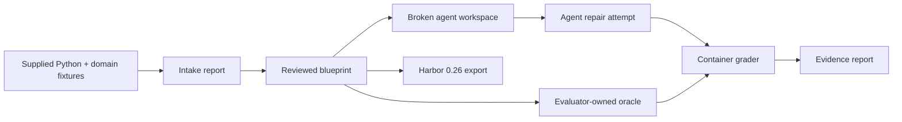

# TaskFoundry

### Build verifiable agent tasks from Python code and domain data — by Tabish Syed

TaskFoundry turns a supplied Python transformation, structured data fixtures, and an explicit business contract into a reproducible agent task. It compiles a broken workspace, visible examples, evaluator-owned held-out cases, a reference implementation, a hardened local grader, and a Harbor-compatible export.

The included catalog has **24 synthetic Python data-pipeline repair tasks** across deduplication, time handling, money, joins, reporting windows, and schema evolution. It is designed to show the practical builder work around agent environments: intake, task design, split design, verifiers, reproducible containers, and evaluation evidence.

The catalog contains no customer or third-party source data. It does not claim a real company dataset, model-training result, or anti-cheat security guarantee.

## Run it

Python 3.11+ and Docker are required for the container evaluator. No model API, GPU, or cloud account is required.

```bash
git clone https://github.com/tabishsyed777/TaskFoundry.git
cd TaskFoundry
python3 -m venv .venv
source .venv/bin/activate
pip install -e '.[dev]'
taskfoundry build-catalog
pytest -q
taskfoundry build-image
taskfoundry validate --engine docker --repeat 1 --output artifacts/validation-docker.json
taskfoundry browser --output artifacts/browser.html
```

On Windows, activate `.venv\Scripts\activate`. Open `artifacts/browser.html` locally to inspect tasks and validation status. Every command that produces a catalog, export, or browser expects a new output directory; this prevents accidental overwrite of prior evidence.

The recorded validation report shows 24 reference implementations accepted and 24 broken starter versions rejected in Docker. A second process-isolated validation run repeats every starter and reference twice for 96 executions and checks deterministic verdicts.

## What gets built



The agent only sees `pipeline.py`, a written contract, and two visible examples. It does not receive expected outputs for held-out cases, reference code, or evaluator files. The local grader passes candidate inputs through a narrow JSON-over-stdin interface and compares canonical JSON outputs against evaluator-owned expected answers.

## Data intake and task suitability

Run a read-only structural intake report on a supplied directory:

```bash
taskfoundry inspect /path/to/source --output runs/intake.json
```

It parses Python modules without importing them, samples CSV structure without including raw values in the report, and reports potential `transform(data)` entry points. It also records what a lab still needs: an explicit behavioral contract, rights to use or replace the data, independently authored edge-case labels, known broken and working states, and a leakage-aware split plan.

The intake is deliberately conservative. It cannot infer domain truth, licensing permission, privacy safety, or whether a transformation should become a benchmark. Those require human review.

### Blueprint contract

`taskfoundry compile` accepts a JSON blueprint pointing to regular non-symlink source files under a supplied source root. It requires identity, family, split, contract, difficulty, license, provenance, candidate, reference, and cases. Cases must include both visible and held-out entries. Candidate and reference modules must each define `transform(data)`.

```bash
taskfoundry compile \
  --source examples/pipeline-repo \
  --blueprint examples/pipeline-repo/blueprints/latest-record.json \
  --output catalog/latest-record
```

The compiler validates paths, syntax, task identity, JSON serializability, case identity, visibility, and basic provenance fields. It does not execute source code while compiling. Reference code is copied to the oracle directory; fixture labels are authored directly in the catalog rather than generated by running that code.

## Included catalog and split design

| Family | Tasks | Split | Representative failure |
|---|---:|---|---|
| Deduplication | 4 | Train | Equal-version ties, duplicate event replay |
| Time handling | 4 | Train | Offset conversion, instant ordering |
| Monetary arithmetic | 4 | Train | Per-line rounding, remainder allocation |
| Joins | 4 | Validation | Dropped unmatched rows, tenant collision |
| Reporting windows | 4 | Test | Inclusive end boundary, future leakage |
| Schema evolution | 4 | Test | Explicit zero treated as missing, nullable fields |

The splits are by bug family, not random cases. This reduces near-duplicate leakage: a model trained on time-zone transformations does not get a nearly identical time-zone task during test. It does not prove independence from every possible source or pattern.

Every task has two visible examples and nine generated held-out fixtures plus an independently authored boundary fixture. Fixtures vary values and identifiers within a fixed task design. This measures repair of the task contract, not broad data-pipeline competence.

## Grading and threat model

The grader checks real function outputs over visible and held-out inputs. It rejects crashes, timeout, oversized output, invalid JSON, non-finite values, incorrect result counts, and output mismatches. It does not accept a success message, a changed test, or a hardcoded visible example as evidence of success.

For direct evaluation, the candidate runs in a pinned Python image with:

- no network (`--network none`)
- a read-only filesystem, except a small temporary filesystem
- no Linux capabilities, no new privileges, and a non-root user
- 256 MiB memory, one CPU, 32 processes, 3 CPU seconds, and a bounded output stream
- exactly one read-only mount: the submitted `pipeline.py`

The evaluator sends only inputs over stdin. Expected answers and the comparison logic stay outside the candidate container. It treats candidate output as untrusted. The direct runner is an isolation measure, not a guarantee against all container or kernel escape attacks.

The process engine exists for fast local tests but is not a sandbox. Use the Docker engine for task validation and grading evidence.

## Validate a candidate

```bash
taskfoundry grade \
  --task catalog/latest-record \
  --candidate path/to/pipeline.py \
  --engine docker \
  --output runs/grade.json
```

Only the named candidate file is mounted into the container. A nonzero process result, timeout, malformed output, or mismatch writes a failure report and exits nonzero.

## Harbor export

TaskFoundry exports each compiled task to Harbor **v0.26.0** format with schema version **1.4**:

```bash
pip install 'harbor==0.26.0'
taskfoundry export-harbor --catalog catalog --output exports/harbor
harbor run --agent oracle --path exports/harbor/latest-record \
  --jobs-dir runs/harbor --n-concurrent 1 --yes
```

Each exported task has an agent `environment/`, separate evaluator `tests/` image, `instruction.md`, `solution/`, and `task.toml` with `verifier.environment_mode = "separate"`. The checked-in validation record includes a real Harbor 0.26.0 local-Docker run of `latest-record` with the Harbor `oracle` agent and reward 1.0.

Harbor v0.26.0's local Docker provider rejects `network_mode = "no-network"` because it cannot enforce that policy. The export therefore uses `public` metadata for that provider, while TaskFoundry's direct Docker runner enforces `--network none`. A hosted Harbor provider that enforces network controls can change these task fields to `no-network`; that change is not validated here.

## Evidence and reproducibility

- [Docker validation](artifacts/validation-docker.json): 48 executions; each reference passes and each broken starter fails.
- [Process repeat validation](artifacts/validation-process.json): 96 executions; two repeats per candidate/reference and deterministic verdicts.
- [Harbor run record](artifacts/harbor-oracle-result.json): one separate-verifier Harbor execution with reward 1.0.
- [Pinned base-image digest](docs/REPRODUCIBILITY.md): Python image, TaskFoundry and Harbor versions, validation commands, and limits.

Container image build timing and Harbor job time are environment dependent. The expected evidence is pass/fail status and recorded configuration, not wall-clock performance.

## Project layout

- `taskfoundry/intake.py` — read-only source/data structure inspection.
- `taskfoundry/catalog.py` — task contracts, broken versions, references, and directly authored fixtures.
- `taskfoundry/compiler.py` — blueprint validation and task compilation.
- `taskfoundry/execution.py` — direct Docker/process candidate execution and output comparison.
- `taskfoundry/harbor_export.py` — pinned Harbor task-package export.
- `taskfoundry/browser.py` — static catalog browser.
- `tests/` — compiler, isolation, reference/starter, and export tests.
- `artifacts/` — recorded validation evidence and browser preview.

## Limits and next steps

This first version uses synthetic, standard-library Python transformations. It does not ingest private customer data, run an agent benchmark, package a training dataset, upload a Harbor task package, or measure post-training improvement. It has one task domain and a bounded threat model.

Next steps are reviewed task intake from real licensed repositories, versioned dataset manifests, semantic duplicate detection, multiple reference implementations, stronger non-agent baselines, independent evaluator machines, and agent run analysis. A separate project, JudgeForge, will focus on adversarial grader attacks.

## License and authorship

Created by Tabish Syed. [MIT License](LICENSE). AI tools assisted implementation, testing, and documentation.
